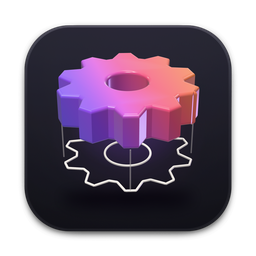
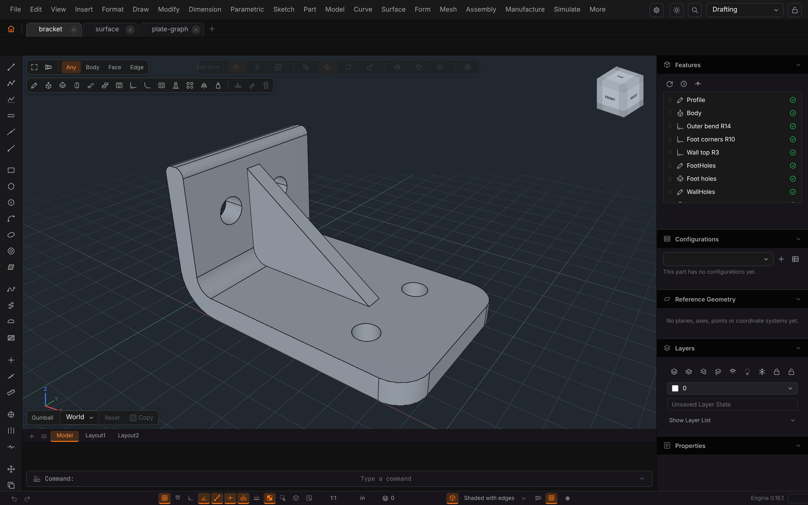
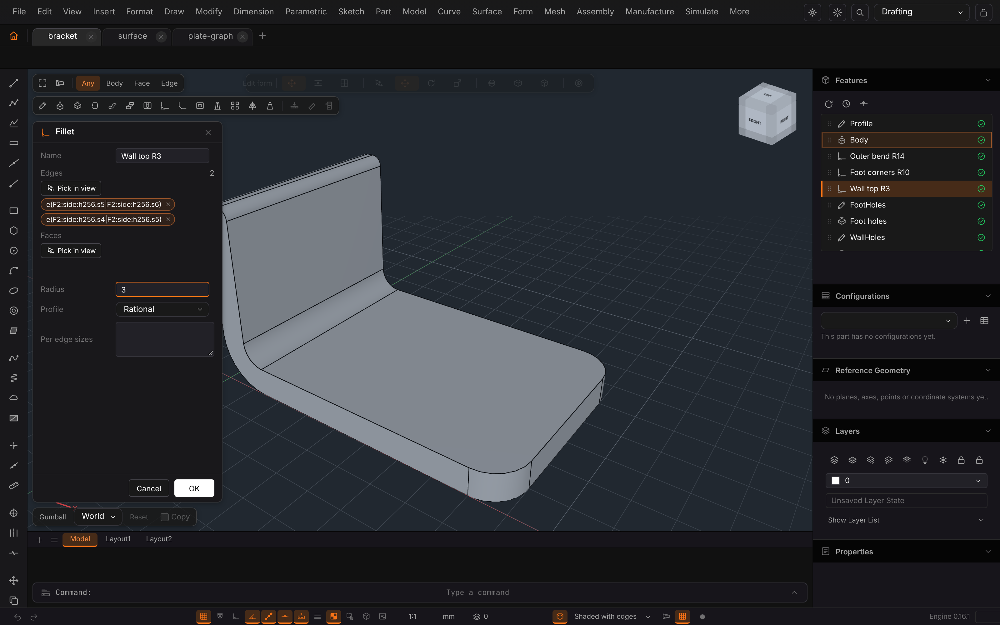
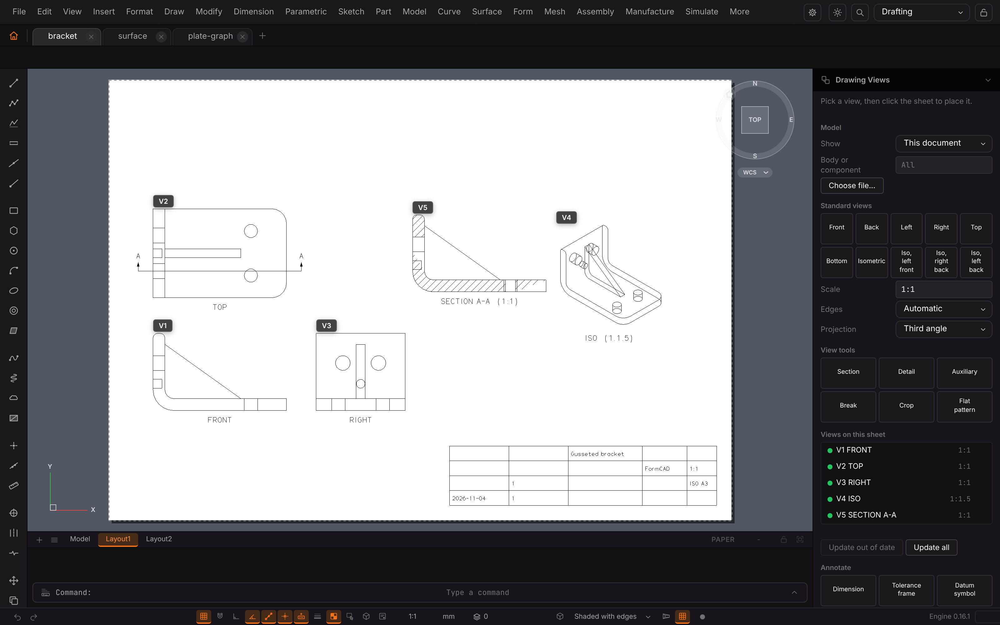
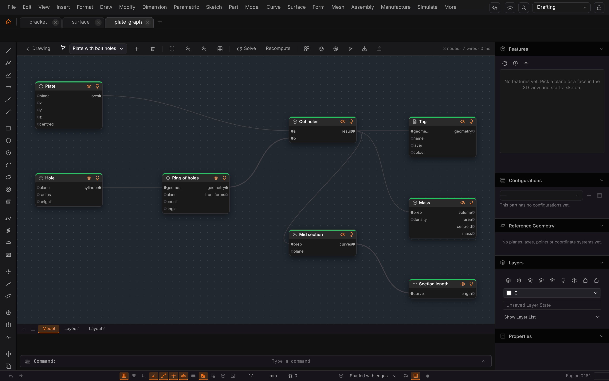
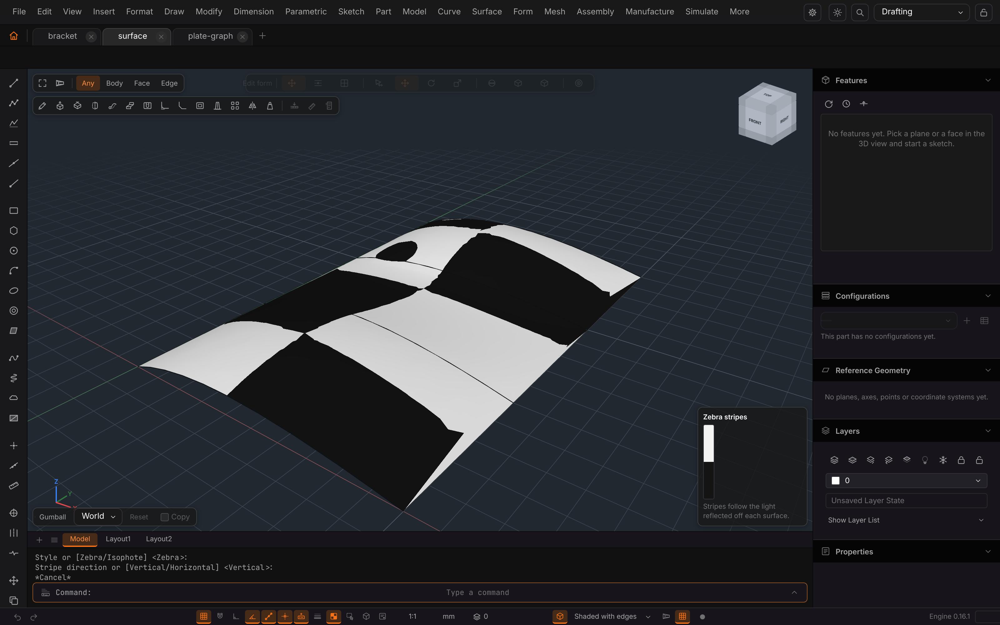

<p align="center">
  
</p>

<h1 align="center">FormCAD</h1>

<p align="center">
  <b>CAD; the CAD studio of the Form family.</b><br>
  2D drafting, parametric parts, NURBS surfaces and automation on an OpenCascade engine,<br>
  on your own computer with no account. Agents drive it over MCP.
</p>

<p align="center">
  
  
  
  
  
  
</p>

<p align="center">
  <a href="https://formai.studio/"><b>Download FormCAD on formai.studio</b></a> ·
  <a href="#run-it-from-source">Run it from source</a>
</p>

<br>

<p align="center">
  
  <br>
  <sub>A gusseted bracket built from sketches, extrudes, fillets and cuts, with its feature tree beside the 3D view.</sub>
</p>

<p align="center">
  <a href="#features">Features</a> ·
  <a href="#everything-in-the-box">In the box</a> ·
  <a href="#built-for-agents">Agents</a> ·
  <a href="#under-the-hood">Under the hood</a> ·
  <a href="#download">Download</a> ·
  <a href="#run-it-from-source">Run from source</a>
</p>

<br>

<table>
  <tr>
    <td width="25%" valign="top"><h3>Drafting</h3>Every 2D command, layers, layouts, blocks and plotting to PDF, PNG and SVG in one project file.</td>
    <td width="25%" valign="top"><h3>Parametric parts</h3>A feature tree with rollback on an OpenCascade kernel, with references that survive edits.</td>
    <td width="25%" valign="top"><h3>NURBS surfaces</h3>Blend and match surfaces to G2, then check the seams with zebra, curvature and deviation analysis.</td>
    <td width="25%" valign="top"><h3>Agent-ready</h3>The same engine from the window, the command line and an MCP server.</td>
  </tr>
</table>

<br>

## Features

<table>
  <tr>
    <td width="50%" valign="top">
      
      <br><sub>Editing a fillet in the feature tree.</sub><h3>Feature tree with rollback</h3>Open any feature, change its radius or depth, and the rest of the part rebuilds. A failed feature is marked with its reason and never silently changes the model.</td>
    <td width="50%" valign="top">
      
      <br><sub>An A3 sheet with projected, isometric and section views.</sub><h3>Drawing sheets from the model</h3>Place base, projected, section and detail views in first or third angle on a layout. Views update when the part changes.</td>
  </tr>
  <tr>
    <td width="50%" valign="top">
      
      <br><sub>A solved node graph: plate, bolt-hole ring, boolean cut, mass and section.</sub><h3>Node graph</h3>Build geometry from wired nodes with data trees, preview it, bake it into the drawing, or run the graph headless from the command line.</td>
    <td width="50%" valign="top">
      
      <br><sub>Zebra stripes across two surfaces and their G2 blend.</sub><h3>NURBS and analysis</h3>Loft, sweep, blend and match surfaces, then read continuity at the seams with zebra, curvature, draft and deviation.</td>
  </tr>
</table>

## Everything in the box

<table>
  <tr>
    <td width="33%" valign="top"><h4>2D and 3D modelling</h4>Draw and modify · Dimensions · Blocks · Layouts and plotting · Sketch constraints · Parts · Assemblies · Drawing views · Sheet metal · NURBS · Subdivision forms · Meshes</td>
    <td width="33%" valign="top"><h4>Engineering workspaces</h4>Weldments · Molds · Toolbox · Costing · Simulation · Generative design · Electronics · Harness and pipe routing · Manufacture · 3D print slicer · Renders</td>
    <td width="33%" valign="top"><h4>Formats</h4>Interchange: DXF, SVG, STEP, IGES, 3DM, STL, OBJ, PLY, 3MF, GLB · Plots: PDF, PNG, SVG · Native: <code>.fcad</code></td>
  </tr>
</table>

## Built for agents

727 commands live in one registry; the window, the CLI and the MCP server all call the same ones.

```sh
./formCAD mcp                                  # MCP server on stdio for Claude Code, Codex and Cursor
python backend/formcad_engine.py commands      # print the command catalogue as JSON
python backend/formcad_engine.py info FILE     # JSON summary of a drawing, headless
python backend/formcad_engine.py graph run FILE.graph   # solve a node graph without the interface
```

Agent rules are in [`AGENTS.md`](AGENTS.md); two skill packs live in [`skills/`](skills): `formcad-harness` and `formcad-driving`.

## Under the hood

- **Interface:** vanilla TypeScript, Vite and three.js for the 3D view, with a WebGL2 drafting canvas.
- **Engine:** Python and FastAPI own every document, command and piece of geometry; the interface only renders and dispatches.
- **Kernel:** a separate OpenCascade 8 worker speaks JSON lines on stdio, so the app itself stays Apache-2.0.
- **Desktop:** a Tauri 2 shell around the engine as a sidecar; the same UI runs in a browser.
- **Scripting:** a LISP dialect, macros, Python macros in an isolated process and hashed plugins.
- **Clean room:** the drafting floor comes from a functional study, never from another product's code.

## Download

| Platform | Download | Release |
|---|---|---|
| macOS | [Download FormCAD for macOS](https://formai.studio/get/formcad/macos) | [FormCAD releases on FormCompiler](https://github.com/nodemode-dev/formcompiler/releases?q=formCAD-v&expanded=true) |
| Windows | [Download FormCAD for Windows](https://formai.studio/get/formcad/windows) | [FormCAD releases on FormCompiler](https://github.com/nodemode-dev/formcompiler/releases?q=formCAD-v&expanded=true) |
| Linux | [Download FormCAD for Linux](https://formai.studio/get/formcad/linux) | [FormCAD releases on FormCompiler](https://github.com/nodemode-dev/formcompiler/releases?q=formCAD-v&expanded=true) |

All FormCAD builds are compiled and released from [FormCompiler](https://github.com/nodemode-dev/formcompiler); this repo holds the source.

## Run it from source

Prefer it in your browser, or want to contribute? Run the web UI straight from this repo.

**Requires:** Node 20.19+ or 22.12+ and Python 3.12+; Rust only for the desktop shell.

```sh
git clone git@github.com:nodemode-dev/formCAD.git
cd formCAD
./formCAD_oc_install     # engine venv and interface packages
./formCAD install-kernel # the OpenCascade worker, needed for 3D
./formCAD                # web UI at http://localhost:5290
```

`./formCAD desktop dev` opens the desktop window instead. On Windows use `formCAD_oc_install.bat` and `formCAD.bat`.

| Service | URL | Notes |
|---|---|---|
| Frontend | http://127.0.0.1:5290 | Vite dev server, strict port |
| Preview | http://127.0.0.1:5291 | `vite preview` of the built interface |
| Backend | http://127.0.0.1:8290 | FastAPI engine, loopback only, per-start token and Origin check |

Set `FORMCAD_DATA_DIR`, `FORMCAD_PORT` or `FORMCAD_KERNEL` in the shell to move the data folder, the engine port or the kernel worker.

**Demos:** open any of the three in a browser, with no install and no network. Each is the real window over a recording of the engine, so you can look, pan, zoom, pick and browse the panels, and anything that would change the document says the desktop app does it. [`demo/index.html`](demo/README.md) opens a dimensioned floor plan on an A3 sheet. [`demos/part/index.html`](demos/part/README.md) opens a parametric plate with its feature tree in the 3D view. [`demos/graph/index.html`](demos/graph/README.md) opens a node graph that drives a plate with a ring of bolt holes. The same three documents open from the home screen of the app.

> [!IMPORTANT]
> **Status:** pre-release. All 43 planned phases have landed, many as first versions; Linux builds are tested here, macOS and Windows builds are configured but untested.

**Contributing:** branch from `main`, keep changes to source here, and leave packaging and releases to formcompiler. See [`BRANCHING.md`](BRANCHING.md) and [`AGENTS.md`](AGENTS.md).

## Repository

`frontend/` the interface · `backend/` the engine · `kernel/` the OpenCascade worker · `mesher/` the Netgen mesher · `src-tauri/` the desktop shell · `setup/` install and boot scripts · `fixtures/` sample documents · `skills/` agent skill packs · `docs/` the manual and format contracts

Docs: [`.docs/wiki`](.docs/wiki) · Manual: [`docs/MANUAL.md`](docs/MANUAL.md) · Agents: [`CLAUDE.md`](CLAUDE.md), [`AGENTS.md`](AGENTS.md) · Contributing: [`BRANCHING.md`](BRANCHING.md)

<br>

---

## Maintainers

| Maintainer | Role |
|---|---|
| [@nodemode-ai](https://github.com/nodemode-ai) | Owner |
| [@gbarnai](https://github.com/gbarnai) | Co-owner |

Code owners are set in [`.github/CODEOWNERS`](.github/CODEOWNERS).

## License

FormCAD is licensed under the Apache License 2.0 ([`LICENSE`](LICENSE), SPDX `Apache-2.0`). Copyright 2026 NodeAgentc, Inc. Third-party notices: [`NOTICE.md`](NOTICE.md).

<sub>Screenshot content: a bracket and a node graph made for this README, plus a sample NURBS surface from `fixtures/`.</sub>
